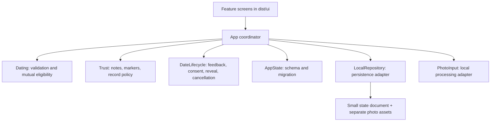

# Architecture review — 20 October 2026

This review preserves the current romance/mystery styling, five-step profile, ten preference cards, photos, demo verification, recognition notes, paid record preview, safety tools and mutual reveal. Work is local. No framework migration, commit, push, deployment, payment or external message was performed.

## Structure after cleanup

| File / folder | Responsibility |
|---|---|
| `dist/app.js` | Navigation, event routing, async search coordination and committing model results |
| `dist/ui/` | Components, preference cards, availability, matching, dates, profile and sheets |
| `dist/app-state.js` | State defaults, safe hydration, v1/v2→v3 migration, draft/date association |
| `dist/date-lifecycle.js` | Pure date-phase, feedback, mutual-reveal, archive and cancellation rules |
| `dist/local-repository.js` | Local storage adapter with photo deduplication and commit/rollback semantics |
| `dist/photo-input.js` | Supported image/size validation, downscaling, object-URL/canvas cleanup |
| `dist/dating-model.js` | Profile/preferences, mutual eligibility, schedules, plans, Vancouver date conversion |
| `dist/trust.js` | Public-note allowlist, heuristic contact checks, structured markers, demo records and stretch policy |
| `dist/core.js` | Fictional data and shared content; real data services are not connected |
| `dist/spring.js`, `dist/icons.js` | Existing shared motion and Phosphor family |
| `scripts/runtime-files.mjs` | The runtime script order read from the actual HTML manifest |

The models have no DOM or browser-storage dependency. They are a useful starting point for the eventual mobile client and server rules. The renderers are still HTML and the adapters still use browser APIs: this is an app demo, not a native app or a production backend. The buildless scripts share a documented global scope; a native/bundled client should expose those model interfaces as modules and replace the fixture data and device adapters.

## Findings corrected

| Finding | Change / evidence |
|---|---|
| One main script mixed rendering, storage, migration and policy | Split screens by feature and isolated models/adapters. The controller went from 121,178 to 33,082 bytes. This is a separation of responsibilities, not a claim that the total bundle shrank by 73%. |
| Every save serialized profile photos again, including when typing unrelated fields | Photos have stable local asset references. A synthetic 20-edit probe performed **zero image rewrites**; its largest state document was 1,427 characters while photos accounted for 240,046 characters. Device latency was not benchmarked. |
| Partial storage failure could be followed by a success message/state transition | Critical profile, verification, plan/unlock, proposal, confirmation, feedback, cancellation and reset changes commit before replacing the active state. Repository failures roll back newly written image assets and preserve the previous committed photos. |
| Reveal rendering trusted submitted/their-answer flags without validating every required condition | A central selector requires the current date, after-date phase, attendance, valid submitted feedback/contact and **both yes answers**. Corrupt/stale feedback cannot create a reveal. |
| Feedback and sample replies were not bound to a unique date | Stable date IDs, date-scoped feedback and one-use partner decisions reject stale replies and duplicate completion. A reschedule retains its date identity. |
| Record unlocks lasted for a person across introductions | Unlocks now use introduction ID + person ID. Legacy grants migrate only to their current introduction. Browser testing confirmed that the same person is locked again on a new introduction. |
| Reported no-shows did not change a persisted counterpart record | Local demo record adjustments persist and feed matching priority. Being stood up never increments your own no-show count. Fixtures are returned as copies, rather than mutable shared records. No live report or moderation service is implied. |
| “Mutual” eligibility did not symmetrically check all of the other person's requirements | One predicate now checks both directions, including energy, activity, pets, smoking, politics and the existing lifestyle/background requirements. Confirmation rechecks requirements after profile edits; an original confirmed date is preserved during a reschedule. |
| The recognition note appeared within 24 hours rather than on the calendar day | A shared selector now compares Vancouver calendar dates. |
| Author CSS overrode the hidden state of car fields | `.field-grid[hidden]` fixes the original cascade. Car details stay hidden unless driving is selected. The browser found this defect and the post-fix check passed. |
| Photo decoding could finish in a newly opened profile draft | Async completion is scoped to the original dialog. Unsupported/oversized files are rejected, dimensions bounded, processing feedback shown, and URLs/canvas memory released. |
| Verification looked too similar to profile completion | Completion uses a check; the demo-verified state uses the seal and explicit demo wording. Ordinary profile edits preserve the existing demo badge, including when an older draft exists. Verification asks for sample files, never a real ID in order to test the demo. |
| Profile tiles restarted the full setup | Answer tiles open their relevant step; photo editing opens the photo step. Full validation still runs before final save. |
| Regex/contact-filter claims were stronger than the mechanism | Outgoing and restored public notes use an allowlist. The heuristic also catches the spoken “six oh four” prefix. A regex cannot prove that all encoded contact messages are impossible. |
| A photo-comparison review tag appeared before photos were revealed | “Matched their description” replaces “Looked like their photos”; old tags migrate. No rating is presented as a photo comparison the person could not yet make. |
| Help/report wording could imply delivery or staff review | Help copies an urgent message and tells the user to send it. Demo reports say they are local and not sent. No call, alert, payment or report was transmitted during QA. |
| Press effects retained old buttons through opposite-event listeners | Cleanup removes both pointer-up/cancel listeners; a 100-tap regression passes. Pointer input switches mode before gesture handlers. |
| Keyboard Enter treated a file input as a form-submit field | File inputs retain their native keyboard action, with visible keyboard focus on the upload control. |
| Syntax tests listed scripts separately from the page | Tests now load exactly the script list/order from `index.html`, check missing literal icons, and run the original and new regression suites. |

## What remains a demo

- Verification is a local demo flag. It proves no identity. A real provider callback, account binding, re-verification policy and retention/deletion rules are still needed.
- Browser storage is not protected production storage for photos, phone numbers, reports, faith/background or other private profile data. The adapter needs replacement, not a promise of native-device security.
- Entitlements, matching, accepted proposal versions, attendance, records and reveal grants must be authoritative on a server. The frontend allowlist is an input constraint, not a security boundary against a modified client.
- A no-show is an allegation until reviewed in a real service. The local demo applies a sample adjustment so the behavior is testable; production needs review, evidence, appeals, abuse controls and idempotent events. Your own no-show count has no live counterpart/review feed in this single-user demo.
- Ratings and comments need verified eligibility and moderation. The public stars/tags + private-note design is preserved. Private notes are not delivered to a team here.
- Calls, trusted-contact messages, push check-ins, payments, membership credits, venue reservations and emergency escalation are not integrated. In particular, copying a help message is not sending one.
- Only sample-person initials stand in for counterpart photos. A real service needs consent-bound photo/contact versions and explicit revocation/retention behavior.

## Useful next updates

1. **A persistent mutual connection:** let someone reopen a completed mutual date and copy the revealed contact. Currently Done archives the date, and past rows do not reopen the contact. Build this as a consent-protected connection record rather than reconstructing access from a profile.
2. **A graceful review exit:** allow leaving/skipping optional rating detail so a person is not blocked from future introductions. Keep the attendance/report and consent decisions explicit, without treating silence as a yes.
3. **Real restaurant partnerships:** add a Partner/perk field and show it only for an actual agreement. Keep sponsored placement distinct from dietary fit and meeting suitability. No fictitious perk or endorsement was added.

Stabilize these contracts before adding more filters or animations. For native work, retain the current phone navigation and motion presets while implementing native screens, secure storage, camera/photo handling, notifications, sharing and accessibility with platform APIs.

## Verification and limits

`npm run check` checks the shipped script manifest and runs four suites: existing domain/navigation/spring behavior; persistence/lifecycle/eligibility regressions; image processing/lifecycle regressions; and spring event-listener cleanup. Regression checks include rollback on storage failure, photo write deduplication, legacy migration, symmetric requirements, changed profiles, exact calendar-day privacy, stale replies, mutual reveal, cancellation exceptions and durable no-show adjustments.

Browser QA uses an isolated localhost port and fictional sample data, with a venue photograph as the upload fixture. It checks phone widths 390 and 375, both themes, all five setup steps, all ten preference cards, core tabs, planning/proposals, recognition, paid/demo membership states, check-ins/help, verification and feedback/reveal. It includes real reloads, real file-input handling, clipboard verification and per-introduction unlock checks. A coverage summary and screenshot are under ignored `qa/`; current observations and unresolved limits are recorded separately from earlier audit history in `UX-PRINCIPLES.md`.

Still open: physical iPhone keyboard/safe-area/reachability and touch behavior, VoiceOver, large/Dynamic Type text, exhaustive composited/image contrast and real-user testing. The browser's zoom rounds the small viewport to 375×668 instead of exactly 375×667. Nothing here establishes native-iOS quality, production security or measured romantic/usability outcomes.
